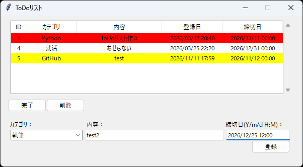
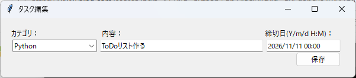

# ToDo Manager

Pythonで開発した、タスク管理用デスクトップアプリケーションです。 \
タスクの登録・編集・完了管理に加え、期限に応じた表示の切り替えなど、日々のタスクを視覚的に管理できるように開発しました。

## 主な機能

- タスク登録：タスクの内容、カテゴリ、期限を登録
- タスク編集（編集したいタスクをダブルクリック）：登録済みタスクの内容を変更
- タスク削除（削除したいタスクを選択して「削除」ボタン）
- タスク完了（完了したタスクを選択して「完了」ボタン）
- 期限に応じた色分け表示
  - 期限切れの未完了タスク：赤色
  - 24時間以内に期限を迎える未完了タスク：黄色
- タスクソート：カテゴリ・日付などを基準にタスクをソート
- データベース管理：SQLiteを使用してタスク情報を保存

## 動作画面
 \

## 使用技術

- Python
- SQLite
- Tkinter

## 開発の工夫

1. タスクの状態を視覚的に把握できる表示 \
期限切れのタスクや、24時間以内に期限を迎えるタスクを色分けすることで、優先して対応すべきタスクを把握しやすくしました。
2. SQLiteによるデータ管理 \
SQLiteを使用し、タスク情報をデータベースで管理しています。 \
タスクごとにIDを付与することで、個々のタスクを識別できるようにしました。
3. データベースの状態を考慮したエラー対策 \
データベースが存在しない場合など、通常とは異なる状態も想定して動作を確認し、エラーへの対策を実装しました。
4. ダミーデータ生成（`dummy_data.py`） \
動作確認やテストを効率よく行うため、任意の件数（デフォルト30件）のダミータスクを生成できる仕組みを用意しました。 \
タスク件数を変更することで、少数のデータから大量のデータまで、さまざまな条件で動作を確認できます。

## 今後の改善予定

- 未完了タスクの残り日数を可視化する横棒グラフ
- 完了済みタスクの分析・可視化

ご覧いただきありがとうございます！
